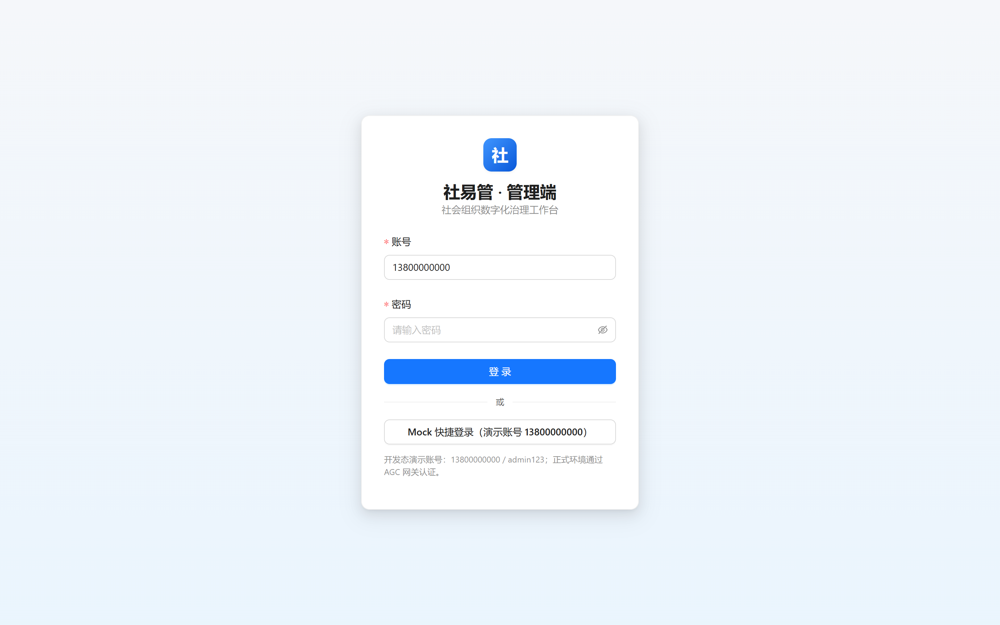
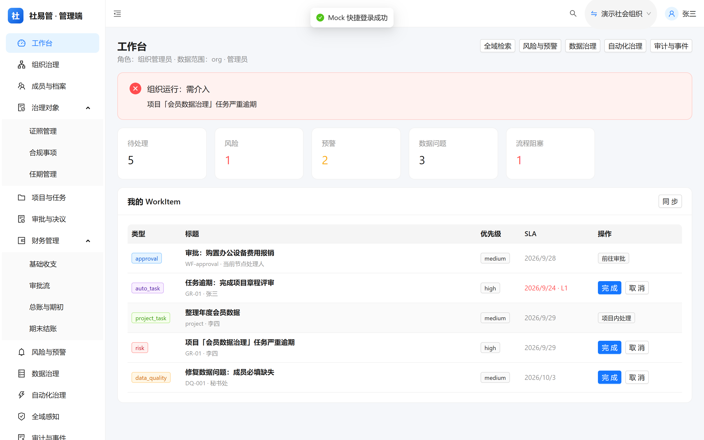
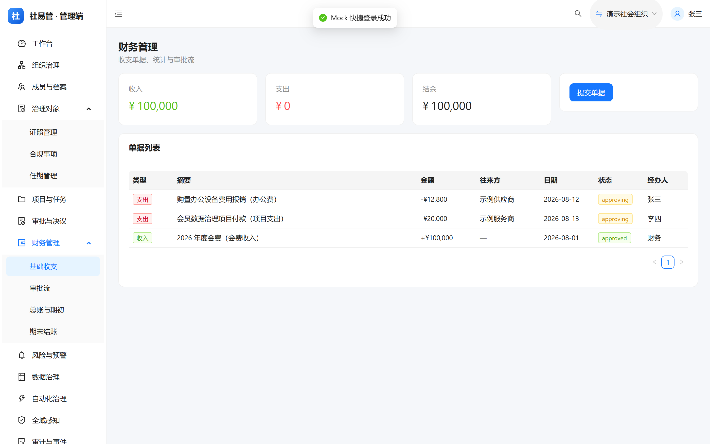
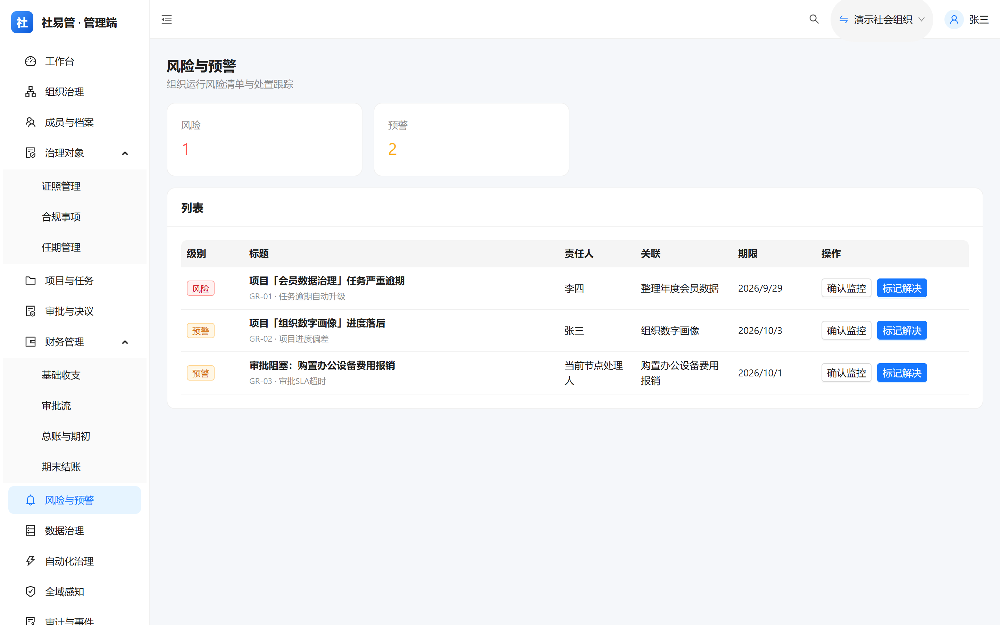
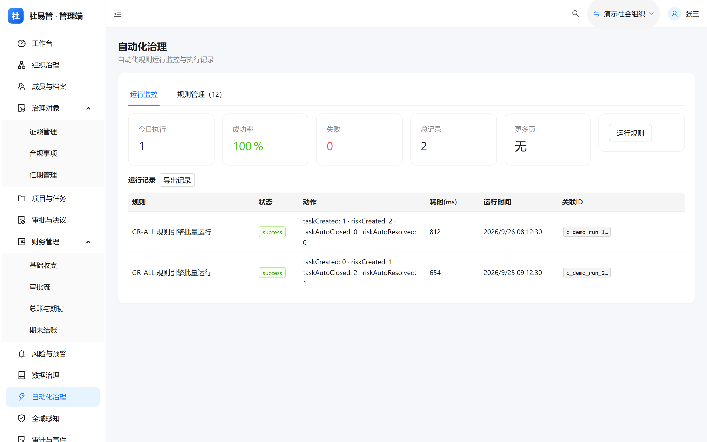
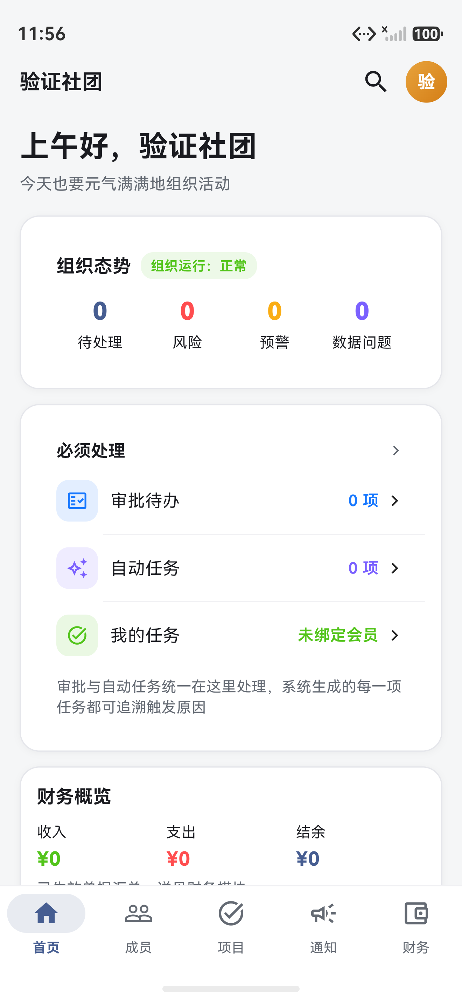
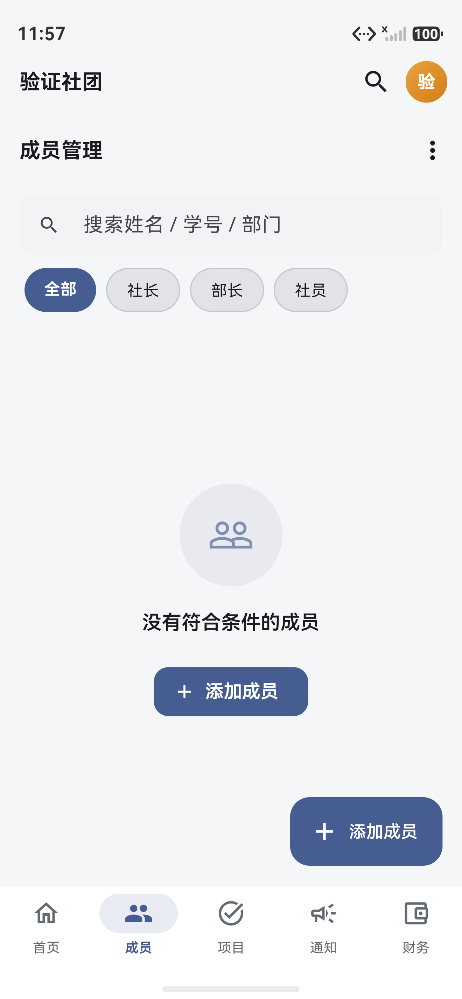
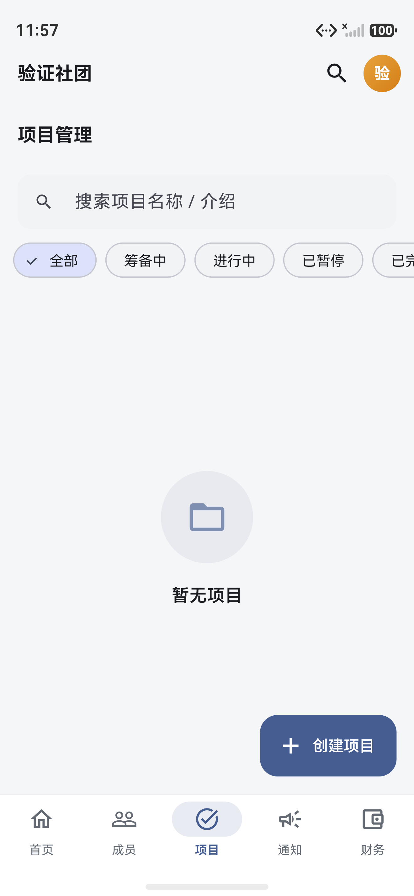
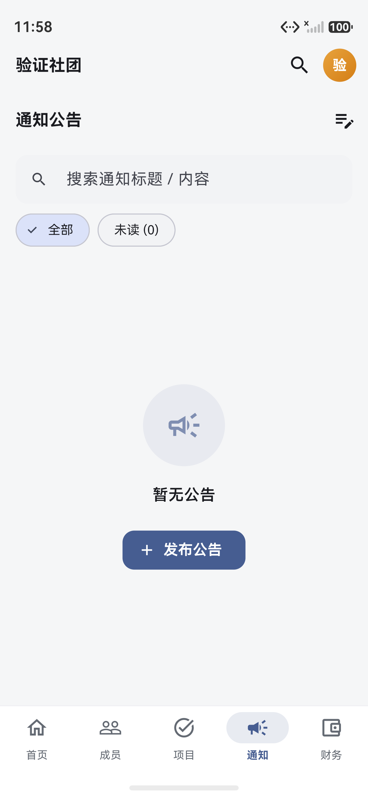
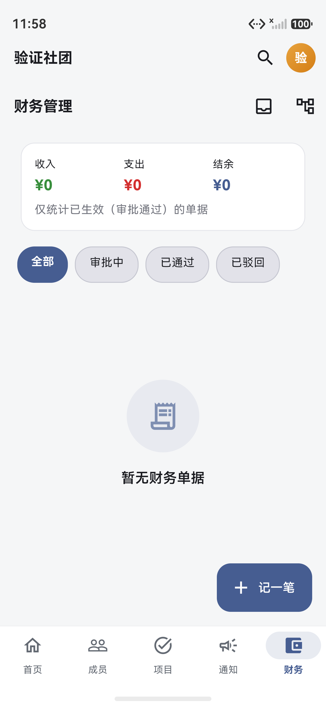

# 社易管（SmartSociety）

<p align="center">
  
</p>

<p align="center">
  
  &nbsp;
  
  &nbsp;
  
  &nbsp;
  
  &nbsp;
  
</p>

面向**学校社团、志愿服务队、社会团体**的多组织数字治理平台。一个华为账号可同时加入并管理多个组织。
- **移动管理端**（HarmonyOS NEXT）：驾驶舱、全域检索、统一待办、风险钻取、同步中心
- **Web 管理端**：React 19 + Ant Design 5 管理控制台，共用同一套云函数业务 API
- **跨端认证**：华为 Account Kit 一键登录 + 账密注册，统一内部 userId
- **双向同步**：本地优先、离线入队、联网自动推送与拉取合并
- **自动化治理**：规则引擎 GR-01~12、数据质量与健康度、审计日志与事件关联链

## 截图预览

Web 管理端（mock 模式，设计令牌对标钉钉/飞书）：

| 登录页 | 工作台 |
|--------|--------|
|  |  |

| 财务管理 | 风险与预警 | 自动化治理 |
|----------|------------|------------|
|  |  |  |

移动端（HarmonyOS 模拟器 Pura 90 实测）：

| 首页 | 成员 | 项目 |
|------|------|------|
|  |  |  |

| 通知 | 财务 |
|------|------|
|  |  |
---

## 技术栈

| 层 | 技术 |
|----|------|
| 移动 UI | Flutter（Dart 3.11），Flutter-OH 3.41 |
| 原生壳 | HarmonyOS（ArkTS，API 26） |
| Web 管理端 | React 19 + TypeScript strict + Vite 7 + Ant Design 5 + TanStack Query + Zustand |
| 账号认证 | 华为 Account Kit |
| 云开发 | 华为 AGC Serverless（云函数 + 云数据库 + 云存储） |
| 混合通信 | MethodChannel（存储路径 / 云函数 / 认证桥接） |
| 测试 | Vitest + RTL + Playwright（Web）、flutter_test（移动） |

---

## 仓库结构

```
smart_society/                     # 仓库根目录
├── README.md / CONTRIBUTING.md / SUPPORTED.md
├── screenshots/                   # 截图与徽章资源
├── docs/                          # 文档（架构/契约/部署/安全/规范/路线图/FAQ）
├── mobile/                        # 手机端 · 端云一体化工程（DevEco Studio 打开此目录）
│   ├── Application/               # Flutter 业务代码 + HarmonyOS 原生壳
│   └── CloudProgram/              # 云侧工程（32 对象类型 + 80 云函数）
└── web/                           # Web 管理端（React 19 + TS strict + AntD5）
```

> DevEco Studio 请打开 `mobile/` 目录（工程根仅含 `Application/` 与 `CloudProgram/`）。

---

## 快速开始

### 环境要求

| 工具 | 版本 | 备注 |
|------|------|------|
| Flutter-OH | **3.41.10-ohos-1.0.1** | 鸿蒙定制版 |
| DevEco Studio | 6.1+ | 含 HarmonyOS SDK |
| JDK | 17 | 构建必需 |
| Node.js | 18+（Web 建议 20+） | pnpm |

环境变量：`DEVECO_SDK_HOME`、`HOS_SDK_HOME`。详见 [`SUPPORTED.md`](SUPPORTED.md)。

### 移动端

```bash
cd mobile/Application
flutter pub get
flutter analyze && flutter test   # 门禁
flutter run --debug -d <deviceId>
```

### Web 管理端

```bash
cd web
pnpm install
pnpm typecheck && pnpm lint && pnpm test && pnpm build   # 四门禁
pnpm smoke                                               # Mock 冒烟（68 项断言）
pnpm dev                                                 # 默认 mock 模式
```

Mock 模式无需云端配置即可完整体验；对接真实 AGC 网关见 [docs/deployment.md](docs/deployment.md)。

---

## 文档导航

| 文档 | 说明 |
|------|------|
| [docs/architecture.md](docs/architecture.md) | 端云架构、三端定位、混合通信、同步机制、数据隔离、十项设计原则 |
| [docs/data-contract.md](docs/data-contract.md) | 统一字段契约、32 张对象类型、事件/工作项契约 |
| [docs/api-contract.md](docs/api-contract.md) | 业务动作规范、幂等契约、80 个云函数分类列表 |
| [docs/deployment.md](docs/deployment.md) | 云函数部署、AGC 联调、Web 接入网关、验收清单 |
| [docs/cloud-storage-security.md](docs/cloud-storage-security.md) | 桶安全规则、目录布局、文件上传模型 |
| [docs/identity-spec.md](docs/identity-spec.md) | 跨端统一身份、四层身份模型、userId 设计要求 |
| [docs/roadmap.md](docs/roadmap.md) | 产品路线图、里程碑、近期方向 |
| [docs/faq.md](docs/faq.md) | 常见问题速查 |

---

## 里程碑

| 阶段 | 状态 | 交付物 |
|------|------|--------|
| 核心 UI / 角色体系 / 本地持久化 | ✅ | Flutter-OH 工程、分级角色、Hive 多盒 |
| 端云一体化（V2） | ✅ | 7 云函数 + 3 张表 |
| **多组织架构（V3）** | ✅ | 华为账号认证、多组织管理、自动同步 |
| 80 云函数 + 32 表部署至 AGC | ✅ | 全量云函数与对象类型部署 |
| **事件/数据治理/自动化治理（V4.1）** | ✅ | 规则引擎 + 任务/风险中心 + 运行审计 |
| **组织态势/移动端体验/数字画像** | ✅ | 管理驾驶舱、全域检索、统一待办 |
| **Web 管理端（W0~W4）** | ✅ | React19 管理台全功能；Mock 68 项冒烟全绿 |
| **治理规则启停与 UI 现代化** | ✅ | ruleConfig 启停、双端设计令牌同源 |
| 测试优化 / 打包上架 | ⏳ | 功能回归、签名证书、上架审核 |

---

## 许可证

本项目基于 **GPL-3.0** 许可证发布，全文见 [`LICENSE`](LICENSE)。贡献内容将遵循同一许可证授权（详见 [`CONTRIBUTING.md`](CONTRIBUTING.md)）。
