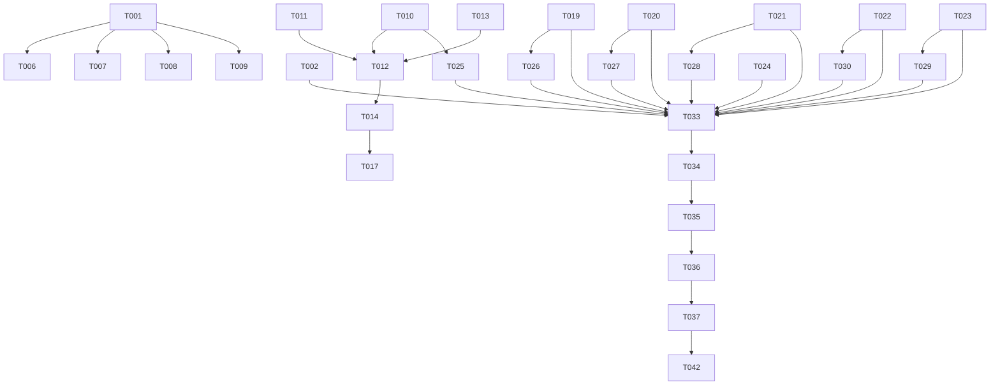

# Tasks: 仓库文档优化整合——面向公开仓库

**Input**: Design documents from `spec/docs-optimize/`
**Prerequisites**: plan.md (required), spec.md (required for user stories)

**Tests**: 未显式要求，不生成测试任务。

**Organization**: 任务按用户故事分组，确保每个故事可独立实施和验证。

## Format: `[ID] [P?] [Story] Description`

- **[P]**: 可并行执行（不同文件，无依赖）
- **[Story]**: 所属用户故事（US1, US2, US3...）
- 描述中包含具体文件路径

---

## Phase 1: Setup（目录与基础设施）

**Purpose**: 创建 .github/ 目录结构，确保后续文件写入有正确路径

- [X] T001 创建 .github/ISSUE_TEMPLATE/ 目录结构（.github/ 目录及子目录）
- [X] T002 [P] 创建 docs/ 备份标记，记录当前 7 个中文文件名列表以便后续验证链接更新

**Checkpoint**: 目录结构就绪

---

## Phase 2: Foundational（新建独立文档——无依赖的前提文件）

**Purpose**: 新建所有不依赖旧文件内容的独立文档，这些文件内容为全新创作

**⚠️ CRITICAL**: 这些文件不依赖旧文档迁移，可全部并行创建

- [X] T003 [P] 新建 CHANGELOG.md（仓库根），基于 README 里程碑表格扩展为版本变更记录（V2→V3→V3.2→V4.1→V4.2→V4.3）
- [X] T004 [P] 新建 CODE_OF_CONDUCT.md（仓库根），采用 Contributor Covenant v2.1 中文版
- [X] T005 [P] 新建 SECURITY.md（仓库根），包含支持的版本、报告渠道（GitHub 安全公告+邮箱备用）、响应承诺、公开披露政策
- [X] T006 [P] 新建 .github/ISSUE_TEMPLATE/bug_report.md，包含标题/问题描述/复现步骤/期望行为/实际行为/环境信息/截图
- [X] T007 [P] 新建 .github/ISSUE_TEMPLATE/feature_request.md，包含功能描述/解决的问题/建议方案/替代方案/补充信息
- [X] T008 [P] 新建 .github/ISSUE_TEMPLATE/config.yml，配置 blank_issues_enabled: false
- [X] T009 [P] 新建 .github/PULL_REQUEST_TEMPLATE.md，包含变更描述/关联Issue/变更类型/门禁检查清单/自测结论

**Checkpoint**: 7 个社区标准文件全部就绪

---

## Phase 3: User Story 1 & 2 - README 精简 + 部署指南整合（Priority: P1）🎯 MVP

**Goal**: 精简 README.md 至 ≤150 行，创建完整部署指南，实现评估者快速了解 + 部署者一站式部署

**Independent Test**: README.md 行数 ≤150；docs/deployment.md 包含完整部署流程；README 中无已迁出的详细内容

### 实施任务

- [X] T010 [US1][US2] 新建 docs/deployment.md，整合 README「鸿蒙云开发（AGC）配置」4 个子章节 + docs/AGC部署联调.md 全文内容，按 plan.md 定义的 9 节结构组织（前置要求→应用关联→项目配置→云数据库→云函数部署→Web接入→云存储→验收清单→常见问题）
- [X] T011 [US2] 新建 docs/faq.md，整合 README「常见问题」表格 + docs/AGC部署联调.md「六、常见问题」表格，按通用/部署/移动端/Web 端分类
- [X] T012 [US1] 重写 README.md，精简至 ≤150 行：Logo+徽章→中文简介→截图→精简技术栈→精简仓库结构→快速开始（各3-5行+链接docs/）→文档导航（链接docs/各文件，替代AGC/云函数/通信/同步/隔离/FAQ章节）→里程碑→许可证
- [X] T013 [US1] 从 README.md 迁出云函数总览内容到 docs/api-contract.md（新增云函数完整列表附录节）

**Checkpoint**: README ≤150 行，deployment.md 和 faq.md 就绪，评估者30秒可了解项目，部署者可一站式部署

---

## Phase 4: User Story 3 - 架构文档创建（Priority: P2）

**Goal**: 创建 docs/architecture.md，整合分散在 README 和产品路线图中的架构信息

**Independent Test**: architecture.md 涵盖端云架构/三端定位/混合通信/同步机制/数据隔离/设计原则；README 中对应章节已改为链接

### 实施任务

- [X] T014 [US3] 新建 docs/architecture.md，从 README 迁入混合通信表+同步机制+数据隔离模型，从产品审视与优化路线.md 提取端云架构图+三端定位+十项设计原则，按 plan.md 定义的 6 节结构组织

**Checkpoint**: 架构信息单一信息源就位，README 中对应内容已移除

---

## Phase 5: User Story 4 & 5 - 社区协作文件（Priority: P2）

**Goal**: Issue/PR 模板就位，安全政策可访问

**Independent Test**: .github/ 模板文件存在且内容完整；SECURITY.md 可从仓库根访问

### 实施任务

- [X] T015 [US4] 验证 .github/ISSUE_TEMPLATE/ 三个文件内容完整（bug_report/feature_request/config）
- [X] T016 [US5] 验证 SECURITY.md 内容完整（支持版本+报告渠道+响应承诺+披露政策）

**Checkpoint**: 社区协作基础设施就绪（Phase 2 已创建文件，此处为验证确认）

---

## Phase 6: User Story 6 & 7 - 文档导航索引 + 版本变更记录（Priority: P2/P3）

**Goal**: docs/ 目录有导航索引，版本变更可追溯

**Independent Test**: docs/README.md 包含分类索引+推荐阅读顺序+文件摘要；CHANGELOG.md 包含 V2~V4.3 变更记录

### 实施任务

- [X] T017 [US6] 新建 docs/README.md，包含文档分类索引表（架构/契约/部署/安全/规范/路线图/FAQ）、推荐阅读顺序（先架构→再契约→再部署→再安全→再路线图→再FAQ）、各文件一句话摘要
- [X] T018 [US7] 验证 CHANGELOG.md 内容完整（V2~V4.3 各版本核心变更）

**Checkpoint**: 文档导航就绪，版本变更可追溯

---

## Phase 7: docs/ 文件重命名与迁移（核心迁移阶段）

**Purpose**: 将旧中文文件名文档内容迁移到新英文文件名文档，删除旧文件

**⚠️ CRITICAL**: 此阶段必须严格按顺序执行，先创建新文件再删除旧文件，避免内容丢失

- [X] T019 [P] 新建 docs/api-contract.md，基于 docs/业务API契约.md 内容重写，补充从 README 迁入的云函数总览（80个函数完整分类列表）作为附录节，去除重复的 README 引用，更新文档内交叉引用链接指向新文件名
- [X] T020 [P] 新建 docs/data-contract.md，基于 docs/云数据契约.md 内容重写，去除与 README 重复的表清单描述（README 仅保留链接），更新文档内交叉引用链接指向新文件名
- [X] T021 [P] 新建 docs/cloud-storage-security.md，基于 docs/云存储安全策略.md 内容重写，小幅优化结构与标题，更新文档内交叉引用链接指向新文件名
- [X] T022 [P] 新建 docs/identity-spec.md，基于 docs/跨端统一用户身份与唯一标识规范.md 内容重写，小幅优化，更新文档内交叉引用链接指向新文件名
- [X] T023 [P] 新建 docs/roadmap.md（≤200行），从 docs/产品审视与优化路线.md 精简提取：产品核心定位+产品边界+三端定位（精简版）+已完成里程碑表格+近期方向+核心架构原则十项
- [X] T024 删除 docs/Web开发前审核报告.md（内部审核文档，不适宜公开）
- [X] T025 删除 docs/AGC部署联调.md（内容已迁入 docs/deployment.md）
- [X] T026 删除 docs/业务API契约.md（已替代为 docs/api-contract.md）
- [X] T027 删除 docs/云数据契约.md（已替代为 docs/data-contract.md）
- [X] T028 删除 docs/云存储安全策略.md（已替代为 docs/cloud-storage-security.md）
- [X] T029 删除 docs/产品审视与优化路线.md（已替代为 docs/roadmap.md）
- [X] T030 删除 docs/跨端统一用户身份与唯一标识规范.md（已替代为 docs/identity-spec.md）

**Checkpoint**: docs/ 目录仅包含 8 个英文命名文档 + README.md 索引，旧文件全部清理

---

## Phase 8: User Story 3 补充 - CONTRIBUTING 增强 + web/README 去重

**Purpose**: 增强贡献指南，精简 web/README.md 去除重复内容

- [X] T031 [US3] 增强 CONTRIBUTING.md：补充安全漏洞报告指引（引用 SECURITY.md）、PR 流程细化（Fork→分支→门禁→PR 描述要求）、首次贡献者建议（good first issue 标签）、更新文档内交叉引用链接指向新文件名
- [X] T032 [US3] 精简 web/README.md：移除与根 README 重复的技术栈描述（保留 Web 端特有版本细节）、移除与 docs/ 重复的架构原则（改用链接引用 deployment.md/architecture.md/identity-spec.md/api-contract.md/data-contract.md/cloud-storage-security.md）、更新所有 docs/ 旧文件名链接为新文件名

**Checkpoint**: CONTRIBUTING.md 完整专业，web/README.md 无重复内容

---

## Phase 9: Polish & Cross-Cutting Concerns（交叉引用全局校验）

**Purpose**: 全局校验所有文档间链接，确保零死链、单一信息源

- [X] T033 全局链接校验：检查仓库内所有 .md 文件中的相对路径链接，确保无指向已删除文件的死链（旧中文文件名链接全部更新为新英文文件名）
- [X] T034 单一信息源校验：确认云函数总览只在 api-contract.md 完整呈现、云数据库表清单只在 data-contract.md 完整呈现、AGC 配置步骤只在 deployment.md 完整呈现、架构细节只在 architecture.md 完整呈现，其他位置仅为链接
- [X] T035 行数达标校验：README.md ≤ 150 行、docs/roadmap.md ≤ 200 行
- [X] T036 版本口径一致性校验：确认 README/CONTRIBUTING/SUPPORTED/docs 各文档中的版本号（Flutter-OH 3.41.10、DevEco 6.1+、Node 18+、React 19、AntD 5 等）、云函数数量（80）、CloudDB 对象数量（32）等数字完全一致

**Checkpoint**: 所有文档链接可解析、内容无重复、行数达标、口径一致

---

## Phase 10: Verification

<!-- verification_scope: build-only -->

**Purpose**: 验证所有文档文件完整性、链接有效性、行数达标

- [X] T037 验证仓库根目录文件完整性：README.md、CHANGELOG.md、CODE_OF_CONDUCT.md、SECURITY.md、CONTRIBUTING.md、SUPPORTED.md、LICENSE 均存在且非空
- [X] T038 验证 .github/ 模板完整性：bug_report.md、feature_request.md、config.yml、PULL_REQUEST_TEMPLATE.md 均存在且非空
- [X] T039 验证 docs/ 目录文件完整性：README.md、architecture.md、deployment.md、faq.md、roadmap.md、api-contract.md、data-contract.md、cloud-storage-security.md、identity-spec.md 均存在且非空
- [X] T040 验证 docs/ 目录无旧文件：AGC部署联调.md、Web开发前审核报告.md、业务API契约.md、云数据契约.md、云存储安全策略.md、产品审视与优化路线.md、跨端统一用户身份与唯一标识规范.md 均已删除
- [X] T041 验证链接完整性：所有 .md 文件中的相对路径链接可解析，无 404
- [X] T042 验证行数达标：README.md ≤ 150 行、docs/roadmap.md ≤ 200 行

---

## 📊 Dependency Graph

## ⚡ Parallel Execution Guide

| Phase | Tasks | Required Files | Execution Notes |
|-------|-------|---------------|-----------------|
| Setup (P1) | T001, T002 | .github/ 目录 | 顺序执行 |
| Foundational (P2) | T003-T009 | 7 个社区文件 | **全部可并行**，互不依赖 |
| US1&2 (P3) | T010-T013 | README.md, docs/deployment.md, docs/faq.md, docs/api-contract.md | T010/T011 先行，T012 依赖 T010/T011 完成 |
| US3 (P4) | T014 | docs/architecture.md | 依赖 T012 完成（README 中内容已迁出） |
| US4&5 (P5) | T015-T016 | .github/*, SECURITY.md | 验证确认，可并行 |
| US6&7 (P6) | T017-T018 | docs/README.md, CHANGELOG.md | **可并行** |
| 迁移 (P7) | T019-T030 | docs/* 新旧文件 | T019-T023 **可并行**创建；T024-T030 必须在新文件创建后执行删除 |
| 补充 (P8) | T031-T032 | CONTRIBUTING.md, web/README.md | **可并行** |
| Polish (P9) | T033-T036 | 全部 .md 文件 | 顺序执行，依赖迁移阶段完成 |
| Verification (P10) | T037-T042 | 全部文件 | 顺序执行，依赖 Polish 完成 |

---

## Implementation Strategy

### MVP First（仅 US1 & US2）

1. Phase 1 + Phase 2 → 社区文件就绪
2. Phase 3 → README 精简 + 部署指南
3. **STOP and VALIDATE**: README ≤150 行，部署指南完整
4. 可提交公开

### 完整交付

1. Setup + Foundational → 社区文件就绪
2. US1&2 → README 精简 + 部署指南
3. US3 → 架构文档
4. US4&5 → 社区协作验证
5. US6&7 → 导航索引 + CHANGELOG
6. 迁移 → docs/ 文件重命名
7. 补充 → CONTRIBUTING + web/README
8. Polish → 全局校验
9. Verification → 最终验证

---

## Notes

- [P] 任务 = 不同文件，无依赖，可并行
- [USx] 标签 = 任务对应的用户故事，便于追溯
- Phase 7 迁移阶段严格顺序：先创建新文件→验证内容→再删除旧文件
- 文档内容迁移时保持原意不变，仅优化结构与表达
- 所有交叉引用链接使用相对路径
- 删除旧文件前确认其内容已完整迁移到新文件
- 本特性为纯文档变更，不修改任何源代码
